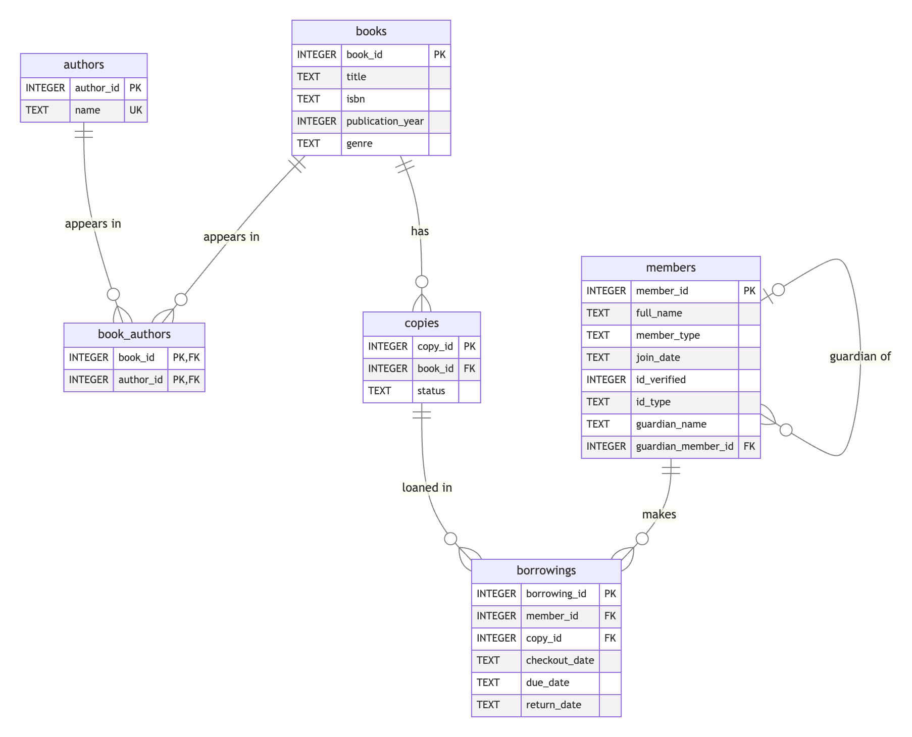
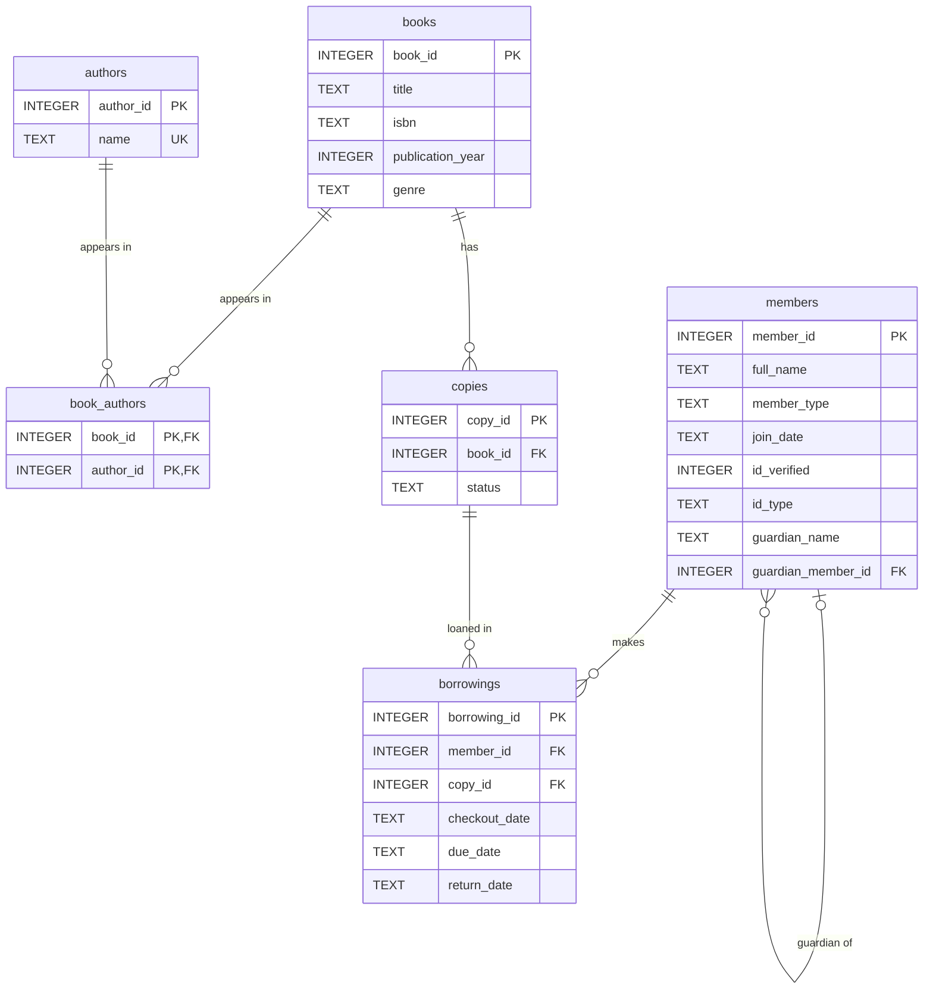

# library.db — Entity-Relationship Diagram & Summary

Mermaid source for the diagram above

## Summary

I am opening a small library, and this database is the system that keeps track of my
books, my members, and who has borrowed what. I designed it so the database — not a
spreadsheet or a loose CSV — enforces the rules about what my data is allowed to look like.

### What each table represents, and why it exists

- **books** — one row per *title* (the work), e.g. "The Hobbit." It holds the facts that
  belong to the work itself: title, ISBN, publication year, and genre. It exists so I have
  a single, authoritative record of each title, independent of how many physical copies I own.
- **authors** — one row per author. I store each author *once* (the name is unique) so that
  "J.K. Rowling" is a single thing I can link to every book she wrote, rather than text I
  retype on each book.
- **book_authors** — the bridge between books and authors. Each row says "this book was
  written by this author." It exists because a book can have several authors and an author
  can write several books, and this table is how the database records those pairings.
- **copies** — one row per *physical copy* on my shelf, each with its own `copy_id` and a
  `status` (available, lost, damaged, or withdrawn). It exists so I can own three copies of
  the same title and track each one separately — one can be lost while the others circulate.
- **members** — one row per cardholder, keyed by their library card number. I keep their
  name, whether they are an adult or a minor, their join date, and a record that I *verified*
  a government ID — but not the ID number itself. Minors carry a guardian reference.
- **borrowings** — one row per checkout event: which member took which copy, when it was
  checked out, when it is due, and when it came back. It exists to record the entire loan
  history, and it is where the library's day-to-day activity lives.

### One-to-many and many-to-many relationships, and how the database tracks them

The database tracks every relationship with **foreign keys** — a column in one table that
must point to a real row in another.

- **One-to-many:**
  - One **book** has many **copies** (`copies.book_id` → `books.book_id`).
  - One **member** has many **borrowings** (`borrowings.member_id` → `members.member_id`).
  - One **copy** has many **borrowings** over its lifetime (`borrowings.copy_id` → `copies.copy_id`).
  - A **member** can be the guardian of many other members — a one-to-many relationship a
    table has *with itself* (`members.guardian_member_id` → `members.member_id`).
- **Many-to-many:**
  - **books ↔ authors.** A database can't store a many-to-many link directly, so I resolve it
    with the **book_authors** junction table. Its primary key is the *pair*
    `(book_id, author_id)`, which lets a book list any number of authors, lets an author be
    linked to any number of books, and prevents the same pairing from being entered twice.

### One design decision I made, and why

I split a **title** from its **physical copies** (the `books` and `copies` tables). The
tempting shortcut is to treat a "book" as one row and call it done, but then I could never
say *which* copy is checked out or lost. By giving every physical copy its own ID and status,
I can own multiple copies of a popular title, retire a single damaged copy, and point each
loan at the exact item that left the building. A related decision followed from this: a copy's
stored `status` only records its *physical condition* (lost/damaged/withdrawn). Whether a copy
is "checked out" or "overdue" is **not stored** — it is *derived* from the borrowings table (an
open loan is one with no return date; it is overdue if its due date has passed). This keeps me
from having to hand-maintain a "checked out" flag that could drift out of sync with reality.

I also chose to protect member privacy: I verify a driver's license or other government ID when
someone signs up, but I store only a verification flag and the ID *type*, never the raw number.
The library card number is the identifier the whole system uses after that.

### One thing I changed

My first instinct for authors was to add several columns to the books table —
`author1`, `author2`, `author3`. I changed this to the `authors` + `book_authors` join table
instead. Fixed columns would have forced me to guess a maximum number of authors, left most of
them empty, and — worst of all — made it impossible to ask a simple question like "show me
everything by this author," because a name could sit in a different column on each book. The
join table handles any number of authors cleanly and makes an author a real, reusable entity.
I also started out thinking I didn't need to track borrowers at all, and realized I couldn't
record *who* holds a book without a members table — so members became a core part of the design.

### The library as it stands

The database currently holds **25 books** by **23 distinct authors**, **58 physical copies**,
**5 members** (including one who has never borrowed), and **11 borrowings**. Grouping the copies
by status gives 53 available, 2 checked out, 1 overdue, 1 lost, and 1 damaged.

